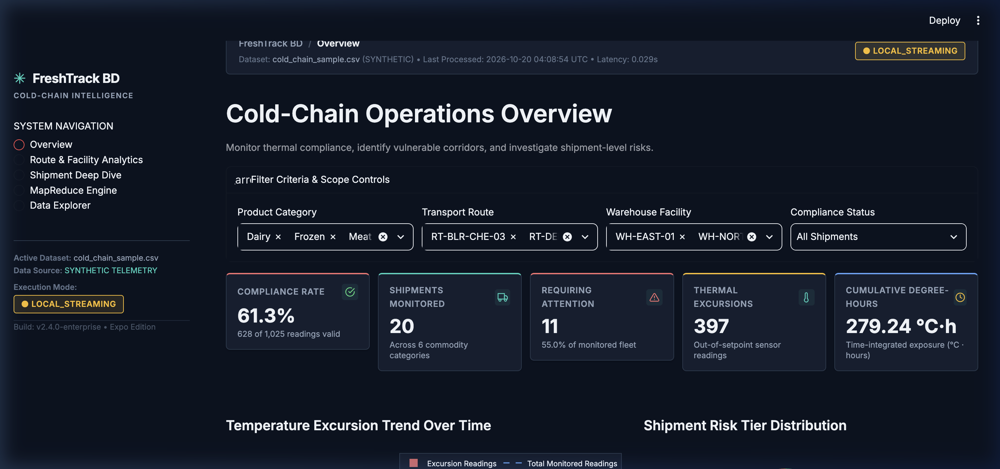
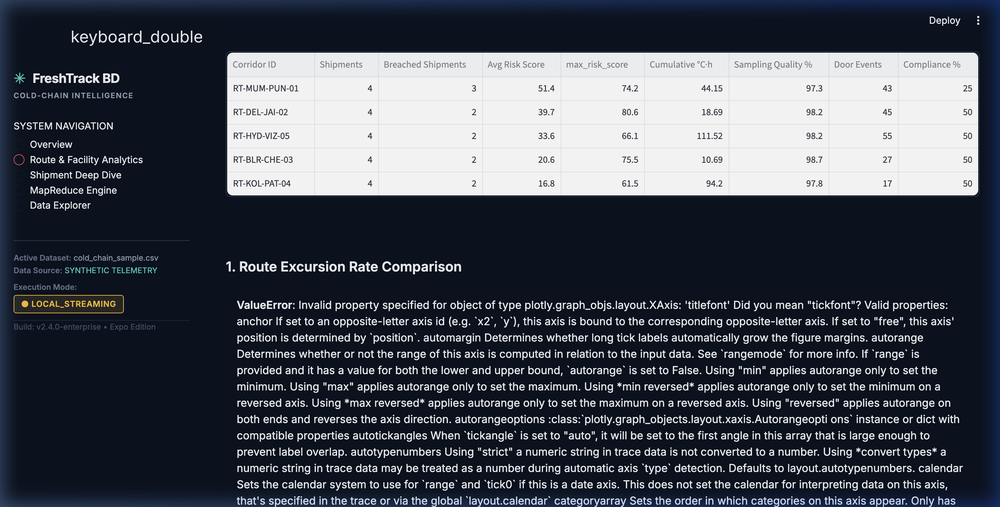
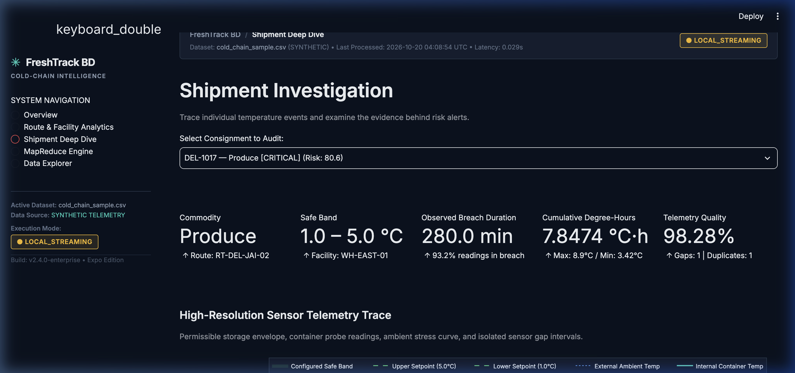
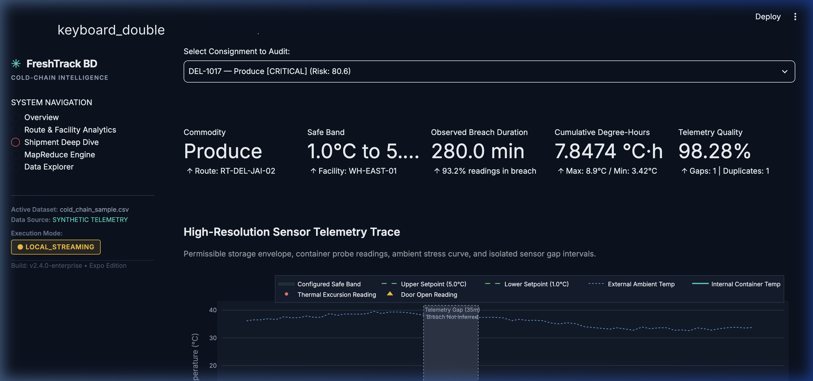
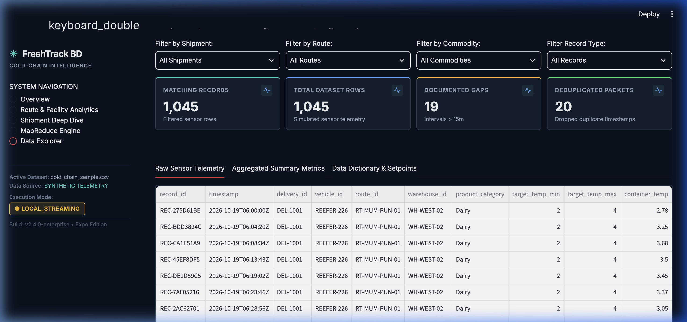

# FreshTrack BD — Intelligent Cold-Chain Risk Analytics Using Big Data

> *"Turning cold-chain telemetry into actionable logistics intelligence."*

[](https://apple.com)
[](https://python.org)
[](https://hadoop.apache.org)
[](https://streamlit.io)
[](https://plotly.com)
[](tests/)

---

## 1. Problem Statement & Objectives

### The Industrial Problem
Refrigerated food distribution ("cold-chain logistics") requires continuous temperature compliance from harvest and manufacturing to retail distribution. In multi-stage transit networks:
- **Catastrophic Thermal Excursions:** Minor mechanical refrigeration failures or loading dock delays cause cumulative thermal stress that degrades product shelf life and safety.
- **Massive Telemetry Volumes:** Fleets of refrigerated vehicles generate millions of high-frequency sensor readings (temperature, ambient stress, GPS, door contacts). Traditional single-node relational databases struggle with the ingestion velocity, time-series aggregations, and quality anomalies inherent in IoT streams.
- **Flawed Data Quality Assumptions:** Naive data pipelines often infer continuous temperature excursions across unobserved sensor blackouts (cellular dead zones, battery exhaustion), artificially exaggerating breach durations or corrupting compliance records.

### Project Objectives
1. **Distributed MapReduce Processing:** Implement a Hadoop Streaming-compatible MapReduce pipeline that processes raw IoT telemetry over standard input/output streams (`stdin`/`stdout`).
2. **Timestamp-Aware Telemetry Cleansing:** Ensure mathematically sound handling of out-of-order records, duplicate timestamps, and unobserved sensor outages.
3. **Scientific Thermal Quantification:** Compute Arrhenius-weighted **Mean Kinetic Temperature (MKT)** and cumulative degree-hours to quantify real thermal degradation beyond arithmetic averages.
4. **Logistics Risk Triage:** Aggregate delivery metrics into corridor-level and facility-level risk indexes to identify chronically vulnerable transport routes and storage hubs.
5. **Operational Control Tower:** Provide an enterprise-grade dark-themed industrial dashboard for logistics managers and compliance auditors.

---

## 2. System Architecture & Data Flow

FreshTrack BD separates distributed stream processing from analytics presentation:

```
[Raw IoT Telemetry Stream (CSV)]
              │
              ▼
    [hadoop/mapper.py]
    - Schema validation (14 columns)
    - Corrupt record rejection to stderr
    - Emits Key-Value: <delivery_id>\t<timestamp>\t<container_temp>...
              │
              ▼
    [Partitioning & Sort/Shuffle]
    - Grouped by Key (<delivery_id>)
    - Evaluated via POSIX sort -k1,1 or Hadoop YARN Shuffle
              │
              ▼
    [hadoop/reducer.py]
    - Chronological timestamp sorting per consignment
    - Duplicate timestamp de-duplication
    - Telemetry gap detection (MAX_GAP_MINUTES = 15.0m)
    - Non-inferred excursion accumulation & degree-hours
    - Emits: summary_metrics.csv
              │
              ▼
    [src/analytics.py (Analytics Engine)]
    - Arrhenius Mean Kinetic Temperature (MKT)
    - Multi-factor Operational Risk Scoring (0–100)
    - Transport corridor & storage facility rollups
    - Data-driven operational findings & alerts
              │
              ▼
    [app/main.py (5-View Enterprise Dashboard)]
    ├── Overview (Fleet KPIs & High-Risk Triage)
    ├── Route & Facility Analytics (Corridor Heatmaps)
    ├── Shipment Deep Dive (High-Resolution Traces & Gap Outages)
    ├── MapReduce Engine (Pipeline Transparency & Diagnostics)
    └── Data Explorer (Raw Telemetry Queries & CSV Export)
```

### Transparent Dual-Mode Execution
FreshTrack BD enforces absolute execution truthfulness:
- **`LOCAL_STREAMING` (Unix Pipe Emulation):** On local development environments (e.g., macOS Apple Silicon), the system streams records through `mapper.py`, `sort -k1,1`, and `reducer.py` using pure POSIX standard streams. The dashboard displays `● LOCAL_STREAMING` with `Hadoop Job ID: N/A (Local Pipe Emulation)`.
- **`REAL_HADOOP`:** When deployed to an authenticated Hadoop cluster with active YARN and HDFS daemons, the system submits jobs via `hadoop jar hadoop-streaming.jar`. 

*The project never displays fabricated cluster daemons, fake job IDs, or simulated Hadoop execution.*

---

## 3. Technology Stack & Component Roles

| Technology | Role in FreshTrack BD |
| :--- | :--- |
| **Python 3.12** | Core language for MapReduce streaming scripts, analytics engine, and synthetic data generation. |
| **Apache Hadoop Streaming** | Distributed processing protocol standard; scripts adhere strictly to `sys.stdin` $\to$ `sys.stdout` tab-delimited streams. |
| **POSIX Standard Streams** | Local streaming orchestration via Unix pipes (`cat \| mapper \| sort \| reducer`) matching Hadoop streaming behavior. |
| **Streamlit 1.30+** | Multi-page enterprise presentation layer and interactive operator interface. |
| **Plotly Dark Industrial** | Interactive data visualization (dual-axis excursion trends, risk distributions, route heatmaps, and telemetry traces). |
| **NumPy & Pandas** | Vectorized mathematical computation (Arrhenius exponential terms, matrix aggregations, and parity verification). |

---

## 4. Synthetic Data Generation & Schema

Telemetry data is generated via [src/data_generator.py](file:///Users/deyaaswinid/Desktop/FreshTrack%20BD/src/data_generator.py) based on physical food science parameters across 6 commodities:

| Product Category | Safe Temperature Envelope | Common Physical Vulnerabilities Modeled |
| :--- | :---: | :--- |
| **Dairy** | $2.0^\circ\text{C}$ to $4.0^\circ\text{C}$ | Moderate thermal inertia; bacterial growth risk above $4^\circ\text{C}$. |
| **Frozen Foods** | $-20.0^\circ\text{C}$ to $-18.0^\circ\text{C}$ | Defrost threshold breaches; refrigeration compressor power outages. |
| **Meat & Poultry** | $-1.0^\circ\text{C}$ to $2.0^\circ\text{C}$ | Strict threshold limits; rapid enzymatic breakdown upon warming. |
| **Fresh Produce** | $1.0^\circ\text{C}$ to $5.0^\circ\text{C}$ | Vulnerable to both warm decay and sub-zero chill/freezing injury. |
| **Seafood** | $-0.5^\circ\text{C}$ to $2.0^\circ\text{C}$ | Highly perishable; rapid quality deterioration outside narrow safe band. |
| **Vaccines / Biologics**| $2.0^\circ\text{C}$ to $8.0^\circ\text{C}$ | Strict USP regulations; cumulative thermal degradation. |

### Telemetry Record Schema (14 Columns)
```csv
record_id,timestamp,delivery_id,vehicle_id,route_id,warehouse_id,product_category,target_temp_min,target_temp_max,container_temp,ambient_temp,door_open_flag,battery_level,transit_status
REC-001,2026-10-20T08:00:00Z,DEL-1001,REEFER-101,RT-MUM-PUN-01,WH-WEST-02,Dairy,2.0,4.0,3.15,28.4,0,94,IN_TRANSIT
```

---

## 5. MapReduce Streaming Workflow

### 1. Mapper (`hadoop/mapper.py`)
- Reads raw CSV telemetry line-by-line from `sys.stdin`.
- Automatically recognizes and skips CSV headers.
- Enforces strict validation: validates 14 columns, checks non-null IDs, and converts temperatures to numeric floats. Malformed rows are reported to `sys.stderr` and discarded without terminating the stream.
- Emits key-value pairs formatted as:
  ```
  <delivery_id>\t<timestamp>\t<container_temp>\t<target_temp_min>\t<target_temp_max>\t<ambient_temp>\t<door_open_flag>\t<product_category>\t<route_id>\t<warehouse_id>
  ```

### 2. Sort & Shuffle
- Keys (`delivery_id`) are sorted lexicographically by the Hadoop infrastructure or local `sort -k1,1`.
- Guarantees that all telemetry for a given consignment arrives at the reducer as a contiguous block.

### 3. Reducer (`hadoop/reducer.py`)
- Reads tab-separated streams from `sys.stdin` and segments records by `delivery_id`.
- **Chronological Sorting:** Telemetry within a consignment is sorted by timestamp to eliminate shuffle ordering artifacts.
- **De-duplication:** Tracks seen timestamps; identical duplicate packets are discarded to prevent false duration inflation.
- **Timestamp-Aware Outage Handling:** Evaluates elapsed time $\Delta t = t_i - t_{i-1}$:
  - If $\Delta t \le 15.0\text{ min}$: Considers the window valid and continuously monitored.
  - If $\Delta t > 15.0\text{ min}$: Increments `gap_count`, reduces `sampling_integrity_pct`, and **freezes** breach accumulation across the unmonitored interval.
- Emits aggregated consignment summary metrics.

---

## 6. Mathematical Formulations & Quality Rules

### Temperature Excursions & Degree-Hours
A reading is classified as an excursion if it breaches permissible bounds:
$$\text{Breach Condition: } T_{\text{container}} > T_{\text{target\_max}} \quad\lor\quad T_{\text{container}} < T_{\text{target\_min}}$$

For valid continuous monitoring windows ($\Delta t \le 15\text{ min}$):
- **Warm Excursion:** $(T_{\text{container}} - T_{\text{target\_max}}) \times \frac{\Delta t_{\text{min}}}{60}$
- **Freeze / Chill Injury:** $(T_{\text{target\_min}} - T_{\text{container}}) \times \frac{\Delta t_{\text{min}}}{60}$

$$\text{Cumulative Degree-Hours } (^\circ\text{C}\cdot\text{h}) = \sum_{i=1}^{N} \Delta \text{Degree-Hours}_i$$

### Mean Kinetic Temperature (MKT)
Calculated according to the **Arrhenius equation** recommended by **USP <1079>** and **FDA guidelines**:

$$T_k = \frac{\frac{\Delta H}{R}}{-\ln\left(\frac{1}{n} \sum_{i=1}^n e^{-\frac{\Delta H}{R \cdot T_i}}\right)}$$

- **Universal Gas Constant ($R$):** $8.314472\text{ J/(mol}\cdot\text{K)}$
- **Standard Activation Energy ($\Delta H$):** $83.144\text{ kJ/mol}$ ($83,144\text{ J/mol}$)
- **Physical Property:** Because chemical reactions accelerate exponentially at higher temperatures, Arrhenius weighting ensures that $T_{\text{MKT}} > T_{\text{arithmetic}}$ for fluctuating temperature profiles.
- **Assumptions & Bounds:** Assumes pseudo-first-order degradation kinetics. Empty series return `None`; inputs $\le -273.15^\circ\text{C}$ raise a `ValueError`.

### Composite Cold-Chain Risk Score
An operational prioritization index ($0 - 100$) designed to triage shipments for physical quality control:

$$\text{Risk Score} = S_{\text{duration}} (40\%) + S_{\text{magnitude}} (35\%) + S_{\text{door}} (15\%) + S_{\text{gap}} (10\%)$$

1. **Duration Ratio ($0 - 40$ pts):** $\min\left(1.0, \frac{\text{observed\_breach\_duration\_min}}{\text{total\_trip\_duration\_min}}\right) \times 40$
2. **Thermal Exposure Magnitude ($0 - 35$ pts):** $\min\left(35.0, \frac{\text{degree\_hours\_excursion}}{4.0} \times 35.0\right)$
3. **Loading Exposure ($0 - 15$ pts):** $\min\left(1.0, \frac{\text{door\_open\_count}}{\text{total\_readings}}\right) \times 15$
4. **Telemetry Visibility Loss ($0 - 10$ pts):** $(100.0 - \text{sampling\_integrity\_pct}) \times 0.10$

| Risk Tier | Score Range | Operational Meaning |
| :--- | :---: | :--- |
| **LOW** | $0.0 - 20.0$ | Thermal profile fully compliant; routine clearance. |
| **MODERATE**| $20.1 - 50.0$ | Minor transient excursions; standard receiving inspection. |
| **HIGH** | $50.1 - 75.0$ | Sustained out-of-spec duration; quarantine for quality inspection. |
| **CRITICAL**| $75.1 - 100.0$| Severe thermal breach or unmonitored loss; mandatory secondary QA assay. |

> [!WARNING]
> **Scientific Disclaimer:**  
> The Cold-Chain Risk Score is an operational prioritization heuristic. It evaluates physical time-temperature compliance and does **not** constitute a biological assay or direct microbial food spoilage prediction.

---

## 7. Verification & Visual Gallery

### Page 1: Operations Overview

*Fleet-wide reading compliance, monitored shipment counts, high-risk flags, degree-hours total, dual-axis excursion trends, and automated operational alerts.*

### Page 2: Route & Facility Analytics

*Transport corridor vulnerability rankings, route-commodity risk matrix heatmap, diurnal excursion frequency, and storage hub loading dock assessments.*

### Page 3: Shipment Deep Dive

*High-resolution sensor telemetry curve with safe storage band, ambient stress curve, excursion markers, distinct unmonitored gap callouts, and Arrhenius MKT.*

### Page 4: MapReduce Engine

*Transparent 7-stage distributed pipeline architecture, live execution metrics, truthful execution mode badges, and intermediate stdout/stderr inspection.*

### Page 5: Data Explorer

*Raw telemetry grid, data quality counters, 14-column schema dictionary, and CSV export capabilities.*

---

## 8. Installation & Quick Start (macOS)

### Prerequisites
- macOS Sonoma / Sequoia (Apple Silicon or Intel)
- Python 3.10+ (Python 3.12 recommended)
- `pip` package manager

### Step 1: Clone Repository
```bash
git clone https://github.com/deyaaswini26/FreshTrack-BD.git
cd FreshTrack-BD
```

### Step 2: Run Environment Diagnostics
```bash
chmod +x scripts/check_env.sh hadoop/run_local_streaming.sh
./scripts/check_env.sh
```

### Step 3: Install Dependencies
```bash
pip install -r requirements.txt
```

### Step 4: Run Unit & Parity Tests
```bash
python3 -m unittest discover tests/ -v
```
*(All 16 unit tests should complete in under 0.5s).*

### Step 5: Launch Dashboard
```bash
streamlit run app/main.py
```
Open **http://localhost:8501** in your browser.

---

## 9. Known Limitations & Roadmap

1. **Local Streaming vs. Cluster YARN:** On macOS environments without Docker or bare-metal Linux, the pipeline runs via POSIX streaming pipes. While execution scripts and mathematical results are 100% parity-verified against Hadoop Streaming, physical distributed node management requires an external Hadoop YARN cluster.
2. **Standardized Activation Energy:** Arrhenius MKT currently defaults to the standard USP <1079> general value of $83.144\text{ kJ/mol}$. Future iterations can introduce commodity-specific activation energies (e.g., lipid oxidation vs. enzymatic browning).
3. **Simulated Telemetry:** Sensor streams are generated with realistic physics-based noise and failure distributions. Production deployment would integrate Kafka or MQTT brokers connected to physical GPS/temperature dataloggers.
